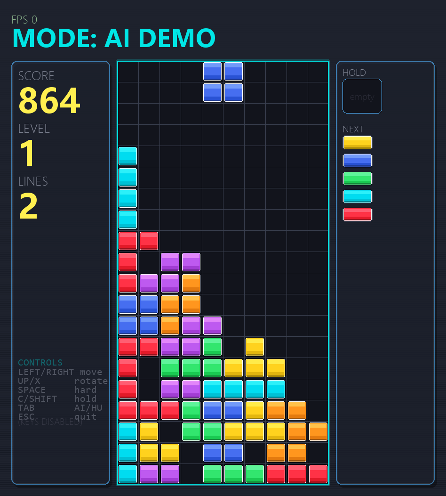

# TetrisMind

俄罗斯方块规则引擎、Pygame 人机界面、启发式 AI 和遗传算法调参的完整集成版本。

## 功能

- P1：7-bag、SRS 旋转/踢墙、Hold、T-Spin、计分和消行
- P2：Pygame 界面、人机切换、回放、倍速和当前方块显示
- P3：落点枚举、六维特征、双层搜索和可执行策略
- P4：遗传算法调参、多进程批量对局、指标统计和实验报告

## 快速运行

```powershell
.\.venv\Scripts\python.exe main.py
```

默认打开人类玩家界面，`TAB` 在人机模式间切换。其他入口：



```powershell
.\.venv\Scripts\python.exe main.py --mode ai
.\.venv\Scripts\python.exe main.py --mode p4 --generations 30
.\.venv\Scripts\python.exe main.py --mode verify
```

无窗口验证：

```powershell
.\.venv\Scripts\python.exe main.py --mode ai --headless --frames 60
.\.venv\Scripts\python.exe main.py --mode p4 --generations 2 --population 6 --games 1 --max-pieces 20
```

固定 30 代实验报告位于
[`exp/results/p4_seed42/report.html`](exp/results/p4_seed42/report.html)。

## 环境

PyCharm 项目解释器：`.venv/Scripts/python.exe`，依赖为 pygame 和 matplotlib：

```powershell
.\.venv\Scripts\python.exe -m pip install -r requirements.txt
```

完整测试：

```powershell
.\.venv\Scripts\python.exe -m unittest discover -s tests -v
```

## 目录

- `engine/`：P1 规则引擎
- `ui/`：P2 渲染、输入与回放
- `ai/`：P3 特征、搜索与策略
- `exp/`：P4 批量对局、GA、统计和报告
- `contracts.py`：P1 到 P2/P3/P4 的正式适配契约
- `tests/`：P4 与集成测试
- `exp/results/p4_seed42/`：固定种子实验报告
- `TetrisMind-complete.zip`：包含全部四个模块的最终交付包

详细热键见 [`TetrisMind_P2_终极版说明书.md`](TetrisMind_P2_终极版说明书.md)，实验接口见
[`exp/README.md`](exp/README.md)。
